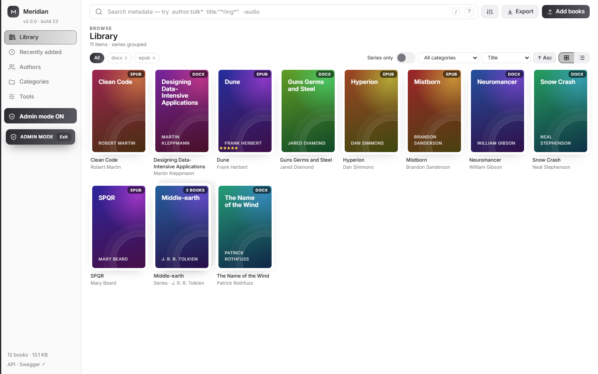
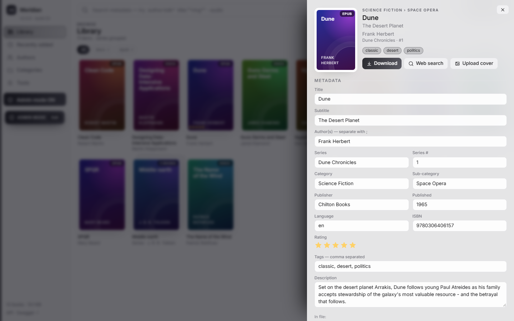
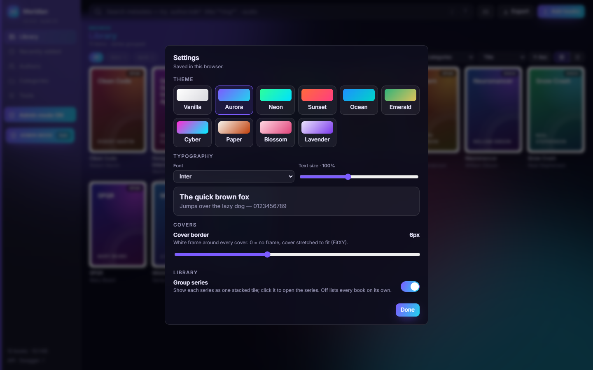
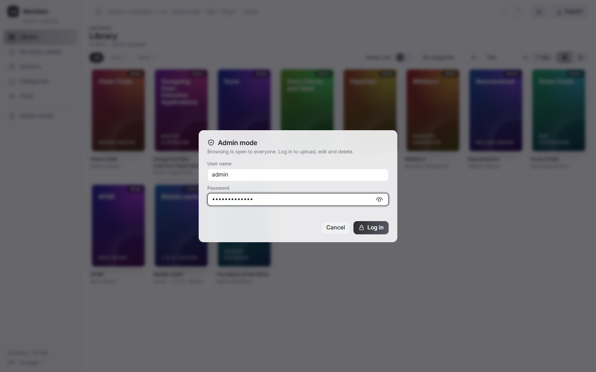

# Meridian Ebooks

A dockerized, self-hosted ebook library: FastAPI backend with a Swagger page, and a Plex-style browser UI.
Runs in one container, including on a Raspberry Pi.

## Highlights

*One bullet per feature - add or remove lines as the app changes. Details live in [Features](#features).*

**Library**
* **Admin mode**: everyone can browse, but uploading, editing and deleting need a login (user and password from environment variables)
* Upload files, whole folders (recursive) or `.zip` archives; EPUB, PDF, DOCX, MOBI, AZW3, FB2, TXT, CBZ and more; give a whole upload a category and a series
* Plex-style cover wall with infinite scroll and series grouping (with a *Series only* switch), plus Authors, Categories and Recently added views
* **Fast covers**: small `book-name_thumb.jpg` thumbnails, loaded after the tiles appear; *Tools > Refresh thumbnails* rebuilds them all
* **List view**: a sortable table with every metadata column (choice remembered per browser)
* **Bulk edit**: select many rows and change category, tags, author and more in one go, or run a clean-up (Title Case, find/replace, trim...) on a field, with a progress bar
* **Delete** one book or many (with a clear warning first); the files and any emptied folders are removed from disk too
* Generated covers for books without one; replace any cover with your own image
* Server-side UUID per book, MD5 duplicate detection and one-call cleanup
* Sharded folder storage derived from the UUID (`1234/5678/abcd/…`)

**Metadata**
* Edit title, subtitle, author, publisher, series, category, sub-category, tags, ISBN, rating and more
* Written into the file for EPUB, PDF and DOCX; stored in a `book-name-info.json` sidecar for other formats
* Title and file name are independent; rename the file separately
* Import metadata from JSON, with a warning and diff when it would overwrite existing values

**Search and export**
* Wildcards (`*`, `?`), field scopes (`author:`, `title:`, `tag:`…), quoted phrases and `-exclusions`
* Export the library as a ZIP organised by category or author, with metadata and covers included

**Interface and API**
* Ten themes (plain Vanilla by default), eleven open-source fonts, adjustable text size and cover borders
* Every action is a REST endpoint, documented with Swagger at `/docs`
* No front-end build step: plain ES modules and native web components

**Deployment**
* Docker Compose with a configurable data folder, port and run-as user; restarts after a reboot
* Works fully offline: fonts and the Swagger page are bundled, so the app never contacts another host
* Admin mode protects changes only; reading is open, so put it behind a reverse proxy (HTTPS) or VPN before exposing it

## Screenshots

<!-- Images live in docs/screenshots/. Regenerate them with scripts/capture_screenshots.py (see Development), or replace a file with the same name; no README edit needed. -->

**Library** - the landing page: a cover wall with format filters, category and sort controls, and a search box that accepts wildcards and field scopes. Books without an embedded cover get a generated one, and a series (here *Middle-earth*) can be collapsed into one stacked tile, and the *Series only* switch hides books that are not in a series. The sidebar shows that admin mode is on.



**Book details** - click any book to open its panel: the cover (with an *Upload cover* button), tags, a *Download* button and the editable metadata form.



**Settings** - choose one of ten themes (shown here: Aurora, one of the dark ones), the font and text size, the cover border thickness, and whether series are grouped. Settings are saved per browser.



**Admin mode** - without a login the app is read-only. Click *Admin mode* in the left menu and sign in with the user and password you set in the environment; the menu then shows an *ADMIN MODE* badge.



## Setting up the data folder

The container runs as a non-root user (UID/GID 1000 by default) and must be able to write to the data folder.
If the folder doesn't exist, Docker creates it owned by `root` and the app fails with
`PermissionError: [Errno 13] Permission denied: '/data/library'`. Create it yourself first:

```bash
mkdir -p data import
# Linux: make the folder writable by the user the container runs as
sudo chown -R "$(id -u):$(id -g)" data
```

Then tell Docker which folder and user to use via a `.env` file next to `docker-compose.yml`
(all values are optional; defaults shown):

```bash
MERIDIAN_DATA=./data        # any absolute or relative path, e.g. /srv/ebooks/data
MERIDIAN_IMPORT=./import    # optional read-only folder for server-side imports
MERIDIAN_UID=1000           # set to the output of `id -u`
MERIDIAN_GID=1000           # set to the output of `id -g`
MERIDIAN_PORT=8000
MERIDIAN_ADMIN_USER=admin             # admin mode: see below
MERIDIAN_ADMIN_PASSWORD=a-long-random-password
```

Or pass them inline: `MERIDIAN_DATA=/srv/ebooks MERIDIAN_UID=$(id -u) MERIDIAN_GID=$(id -g) docker compose up --build`.
On Docker Desktop (Windows/macOS) permissions are usually not an issue.

A ready-made template with every option is in [`.env.example`](.env.example).

**Admin mode.** Anyone who can reach the app can browse, search, download and export. Uploading, editing metadata,
deleting and the maintenance tools need admin mode: click **Admin mode** in the left menu and log in with
`MERIDIAN_ADMIN_USER` / `MERIDIAN_ADMIN_PASSWORD`. While you are in admin mode the menu shows an **ADMIN MODE** badge;
the session lasts 12 hours or until you click **Exit**. If either value is empty, access control is off and every
write is allowed. Scripts can send HTTP Basic credentials instead of logging in. Serve the app over HTTPS (for example
behind a reverse proxy) if it is reachable from outside your own network, because the password is sent when you log in.

## Run

```bash
docker compose up --build
```

* Web UI: <http://localhost:8000/>
* Swagger: <http://localhost:8000/docs> (the raw spec is at `/openapi.json`)
* Data lives in the data folder (`./data` by default: library files + `meridian.db`). Optional `./import` is mounted read-only at `/import` for server-side imports.

### Raspberry Pi: start automatically on boot

`docker-compose.yml` already has `restart: unless-stopped`, so once Docker itself starts at boot, Meridian comes back by itself. One-time setup on the Pi:

```bash
# 1. Install Docker (skip if `docker --version` already works) and let your user run it without sudo
curl -fsSL https://get.docker.com | sudo sh
sudo usermod -aG docker "$USER"        # log out and back in afterwards

# 2. Start Docker at boot (the installer usually does this already)
sudo systemctl enable --now docker containerd

# 3. Get the project onto the Pi and prepare the data folder (see "Setting up the data folder")
cd ~/meridian-ebooks
mkdir -p data import
echo "MERIDIAN_UID=$(id -u)" >> .env
echo "MERIDIAN_GID=$(id -g)" >> .env

# 4. Build and start in the background (-d), so it is not tied to your terminal
docker compose up --build -d
```

Check it: `docker compose ps` should show `meridian` as `running (healthy)`, and the UI is at `http://<pi-address>:8000/` (find the address with `hostname -I`). Test the boot behaviour with `sudo reboot`, then after a minute or two open the UI again. Logs, stop/start, removal and updates are in [Managing the container](#managing-the-container).

Notes:
* A container you stopped yourself with `docker compose stop` stays stopped after a reboot (that is what `unless-stopped` means). Use `docker compose start` to bring it back.
* Keep `data` on the SD card only for light use. For a big library, mount a USB drive or SSD (e.g. at `/mnt/books`), `chown` it to your user, and set `MERIDIAN_DATA=/mnt/books/meridian` in `.env`. Make sure the drive is mounted at boot (an `/etc/fstab` entry with the `nofail` option) so Docker doesn't start the container against an empty folder.

### Raspberry Pi: 32-bit vs 64-bit OS

Both work, including PDF metadata and covers (`pypdf` and `pypdfium2` ship wheels for `armv7l` and `aarch64`). A 64-bit OS (`uname -m` prints `aarch64`) is recommended for speed and memory.

## Managing the container

Run these in the project folder (next to `docker-compose.yml`). Your books and database live in the data folder (`./data` by default), not in the container or image, so none of the commands below delete them.

```bash
docker compose ps                      # is it running / healthy?
docker compose logs -f                 # follow the logs live (Ctrl+C stops following, not the app)
docker compose logs --tail 100         # last 100 lines
docker compose logs --since 30m        # last 30 minutes
docker compose logs -t | grep -i error # timestamps, filtered for errors

docker compose stop                    # stop, keep the container
docker compose start                   # start it again
docker compose restart                 # restart (e.g. after changing .env)

docker compose down                    # stop and remove the container (data folder is untouched)
docker compose down --rmi local        # ...and the image too (frees disk space; the next `up --build` rebuilds it)
docker image prune -f                  # optional: delete dangling layers left by old builds

docker compose up --build -d           # update after pulling new code
```

**Start completely fresh** - this one **does delete your library**; back up the data folder first:

```bash
docker compose down --rmi local
rm -rf ./data                          # or whatever MERIDIAN_DATA points to
mkdir -p data
```

**Check you are running the new build.** The version and build number are shown under the logo (top left of the UI) and at `GET /api/version`. They come from `version.json` in the project root. Run `python scripts/bump_build.py` before building to increase the build number, then confirm the UI shows it. If it still shows the old number, the image was not rebuilt (use `docker compose build --no-cache`); if the number is new but the UI looks old, do a hard refresh (Ctrl+Shift+R).

## Features

| Requirement | How it works |
|---|---|
| Admin mode (access control) | Reading is open. Every route that changes the library (upload, edit, rename, covers, delete, bulk edit, cleanup, server import, thumbnail rebuild) needs admin mode, otherwise it answers `401`. Set `ADMIN_USER` and `ADMIN_PASSWORD` (`MERIDIAN_ADMIN_USER` / `MERIDIAN_ADMIN_PASSWORD` in `.env` for Docker Compose); if either is empty, nothing is restricted. In the UI use *Admin mode* in the left menu (12-hour session, `Exit` to leave). Scripts and Swagger's **Authorize** button use the same user and password as HTTP Basic credentials; `POST /api/auth/login` sets the cookie the UI uses. Five wrong passwords lock a client out for a minute. |
| Upload EPUB, PDF, DOCX, MOBI, AZW3, FB2, TXT, CBZ… | `POST /api/books/upload` (see `app/config.py` for the full list). The Add books dialog can also set a **category** and a **series** for the whole upload (`category`, `series` form fields); a series given here replaces any series the file already has. |
| Upload whole folders recursively | `POST /api/books/upload-folder` takes files plus their relative paths (the UI uses the browser directory picker or drag-and-drop of folders; Chrome asks "Upload N files to this site?" for the picker, which a page cannot turn off, while dropping a folder does not). `.zip` archives are expanded recursively. `POST /api/import` imports a folder already on the server. Folder names can become categories. |
| Import metadata JSON | Upload `*.json` (e.g. an exported `book-name-info.json`) alone, in a folder, in a `.zip`, or from the server import folder. It is matched to the book by `id`, then title (case-insensitive), then file name. **Books are always processed before JSON files.** Empty fields are filled in; if the JSON would change a value the book already has, nothing is applied and you get a `warning` listing each field's current vs. imported value. Tick "overwrite" (`overwrite_json=true`) to apply anyway. A category that was merely inferred from the upload folder name does not count as an existing value. |
| Replace the cover | `PUT /api/books/{id}/cover` (or "Upload cover" in the book panel). Saved as `book-name-cover.jpg` in the book's folder, next to `book-name-info.json`, and always shown instead of the embedded cover. The book file is untouched, the cover follows the file on rename and is included in the ZIP export. `DELETE /api/books/{id}/cover` reverts to the embedded cover. |
| Plex-like browser | Library is the landing page (format/category/sort filters, a *Series only* switch (`in_series=true`), infinite scroll, series shown as one stacked tile that opens the series), Recently added, Authors, Categories, generated covers when a book has none, detail drawer |
| List view and bulk edit | The grid/list switch above the library toggles a table with one column per metadata field; click a heading to sort by it. A coloured dot per row shows the cover's predominant colour (`GET /api/books/colors`). Tick rows (shift-click for a range, or "Select all N" for everything matching the current filter) and press **Bulk edit** to set category, sub-category, tags (add or replace), author, series, publisher, published, language or rating on all of them. It is saved in batches with a percent-complete bar; **Stop** cancels after the current batch. API: `POST /api/books/bulk-update`. The **Advanced** tab of the same dialog cleans up one field instead: pick the field, then an operation - lowercase, uppercase, capitalize, Title Case, replace words (leave "replace with" empty to remove them; whole words and match-case options), collapse multiple spaces, or trim - and press **Run**. The dialog closes and the progress bar appears above the table. Tags are transformed tag by tag, and books that would not change are not rewritten. API: `POST /api/books/bulk-transform`. |
| Metadata search with wildcards | `GET /api/books?q=…` - `*` and `?` wildcards, `author:`/`title:`/`tag:`/`category:`/`format:`/`series:`/`isbn:`/`lang:`/`year:`/`file:` scopes, `"phrases"`, `-exclusions`. Example: `author:tolk* title:"*ring*" -format:pdf` |
| UUID per book + MD5 duplicate control | UUID4 assigned at upload. The MD5 of the upload is unique-indexed; identical content is rejected. The hash is kept even after metadata is written into a file, so the original is still recognised. `GET /api/duplicates` and `POST /api/cleanup` (dry-run by default) remove duplicates, orphan folders and dangling records. |
| Flat sharded storage | UUID hex split 4 chars at a time: `1234/5678/abcd/ef01/…/book-name.ext` (32 hex chars → 8 levels) |
| Library export as ZIP | `GET /api/export?group_by=category` or `author` (optionally `format=`, `ids=`, `include_metadata=`) |
| Metadata editing | `PATCH /api/books/{id}` (many books at once: `POST /api/books/bulk-update`, `POST /api/books/bulk-transform`). EPUB, PDF and DOCX get what they can hold **inside the file**; everything else goes into `book-name-info.json` next to the book. The response's `storage` field shows what went where. |
| Web search | **Web search** in the book panel opens a new browser tab with a web search for the book's quoted title, authors and ISBN (or the word "book" when there is no ISBN), taken from the form as it is right now, including unsaved edits. It is an ordinary link opened by your click: nothing is sent anywhere until you press it, and the app itself never contacts the search site. |
| Delete books | **Book panel > Delete book**, or tick rows in list view and press **Delete** in the bar above the table. A warning dialog explains that it is permanent and lists what will go (for 10 or more books you must also type `delete`); Cancel has the focus, so Enter does not delete. Deleting removes the record **and** the book's folder on disk - the book file, cover and `-info.json` sidecar - then any parent folders left empty. Bulk deletes run in batches with a progress bar and Stop button, and report the space freed. A folder that cannot be removed (for example a file locked by another program) is reported, and **Tools > Duplicates & cleanup** sweeps up such leftovers. API: `DELETE /api/books/{id}`, `POST /api/books/bulk-delete`. |
| Thumbnails | Each book gets a small `book-name_thumb.jpg` (max 400 px high) next to its file, made from the custom cover if there is one, else the embedded cover. New uploads and cover changes update it automatically; **Tools > Refresh thumbnails** (`POST /api/thumbnails/rebuild`, progress at `GET /api/thumbnails/rebuild`) scans the whole library and rewrites all of them. Tiles show the generated cover first and fetch the thumbnail (`GET /api/books/{id}/thumb`) when they come into view; the book panel still shows the full cover. |
| Title ≠ filename | Editing the title never touches the file name. `POST /api/books/{id}/rename` renames the file (and its sidecar) separately. |
| Themes and fonts | Ten themes (Vanilla, the default, plus Aurora, Neon, Sunset, Ocean, Emerald, Cyber, Paper, Blossom, Lavender), eleven open-source fonts and the system font, text size 80-130% (100% = 14.5px), cover border thickness and series grouping, all in Settings (sliders icon, top right) and saved per browser. The fonts are bundled with the app (Latin subset), so nothing is downloaded when you switch. `GET /api/books?group_series=true` returns the grouped view (`series_count` on each entry; filter with `series=` to list one series). |

### What is stored where

| Format | Inside the file | Sidecar `*-info.json` |
|---|---|---|
| EPUB | title, author, publisher, description, language, date, tags, series | category, ISBN, rating |
| PDF | title, author, description (subject), tags (keywords) | everything else |
| DOCX | title, author, description, tags, category, language | everything else |
| MOBI, AZW3, FB2, TXT, RTF, CBZ, … | – | all metadata |

Writing metadata into a file changes its bytes, so the server tracks both the original and the current MD5.

## Development

```bash
pip install -r requirements.txt
DATA_DIR=./data uvicorn app.main:app --reload
```

### Unit tests

The backend has a [pytest](https://docs.pytest.org) suite in `tests/` (no network access is needed). Its dependencies (`pytest`, `pytest-cov`, `httpx`) are in `requirements.txt`; the Docker image leaves them out.

```bash
python -m pytest                      # run everything
```

* **One line per test:** `pytest.ini` turns on `-v`, so each test prints its own `PASSED` / `FAILED` line.
* **95% coverage gate:** the same file adds `--cov=app --cov-fail-under=95`. Each run ends with a coverage table (uncovered lines listed) and **exits non-zero if total coverage of `app/` is below 95%**, which fails the build.
* **CI:** `.github/workflows/tests.yml` runs `python -m pytest` on every push and pull request.

```bash
python -m pytest tests/test_textops.py --no-cov            # one file (a partial run would trip the coverage gate, so skip it)
python -m pytest -k "bulk and not export" --no-cov     # tests matching a name
python -m pytest --cov-report=html                     # browsable report in htmlcov/index.html
```

Add tests next to the feature they cover (`tests/test_<area>.py`, shared fixtures in `tests/conftest.py`).

### Bundled third-party files

The UI fonts (Latin subset, SIL Open Font License; licences in `app/static/fonts/licenses/`) and Swagger UI (Apache-2.0, `app/static/vendor/`) ship inside the repo (see [THIRD_PARTY_NOTICES.md](THIRD_PARTY_NOTICES.md)). A maintainer can refresh them with `python scripts/update_bundled_assets.py` (needs internet; the app itself never does). After adding a font or weight, add its `@font-face` line to `app/static/css/fonts.css`. Characters outside the Latin range fall back to the system font.

### Screenshots

Regenerate the README screenshots against an empty throwaway instance (the script adds demo books and refuses to run on a library that already has books):

```bash
DATA_DIR=./.demo-data uvicorn app.main:app --port 8000     # terminal 1 (add ADMIN_USER=a ADMIN_PASSWORD=b to also capture admin mode,
                                                           # then pass --admin-user a --admin-password b to the script)
pip install playwright                                     # once (uses an installed Edge/Chrome; or `playwright install chromium` and pass --browser chromium)
python scripts/capture_screenshots.py                      # terminal 2 -> docs/screenshots/*.png
```

### Configuration and layout

Environment: `DATA_DIR` (default `./data`), `IMPORT_DIR` (default `./import`), `MAX_ARCHIVE_BYTES`, `ADMIN_USER` and `ADMIN_PASSWORD` (admin mode; both empty = no access control) (see [Setting up the data folder](#setting-up-the-data-folder) for the Compose variables).

Layout: `app/service.py` (ingest, edit, search, cleanup), `app/metadata.py` (EPUB/PDF/DOCX read & write), `app/search.py` (query parser), `app/auth.py` (admin mode), `app/routers/` (API), `app/static/` (UI - plain ES modules and native web components, no build step).

## Notes

* **The app makes no outside requests.** The UI, the fonts and the Swagger page at `/docs` are all served by the app itself (the only link to another site is the book panel's **Web search** button, which opens a new tab when *you* click it), and every page carries a `Content-Security-Policy` that tells the browser not to talk to any other host (`tests/test_offline.py` guards this). ReDoc is therefore not offered: it insists on loading a badge image from another site.
* Metadata is never looked up online: it is whatever is inside the files, an imported JSON, or what you type yourself (one book at a time, or many at once with Bulk edit).
* Admin mode only controls who may change the library; anyone who can reach the app can read and download every book. Put it behind a reverse proxy (HTTPS) or VPN before exposing it.

## Legal

* **Licence:** the project is MIT-licensed ([LICENSE](LICENSE)). The bundled fonts (SIL OFL), Swagger UI (Apache-2.0), icon styles and every Python dependency are listed with their licences in [THIRD_PARTY_NOTICES.md](THIRD_PARTY_NOTICES.md).
* **No copyleft dependencies.** PDF metadata and covers use pypdf (BSD) and pypdfium2 (Apache-2.0 / BSD), so nothing forces your copy of the app, or an image you build from it, under stricter terms than MIT.
* **Your books:** Meridian stores and serves the files you give it and does nothing about copyright or DRM - it neither removes DRM nor supplies content. Keep only books you have the right to keep, and because reading is open to everyone (admin mode only guards changes), do not expose a library to the public internet.
* **Trademarks:** Plex, Raspberry Pi, Docker and other names are trademarks of their owners and are used only to describe compatibility or style; the project is not affiliated with or endorsed by them.
